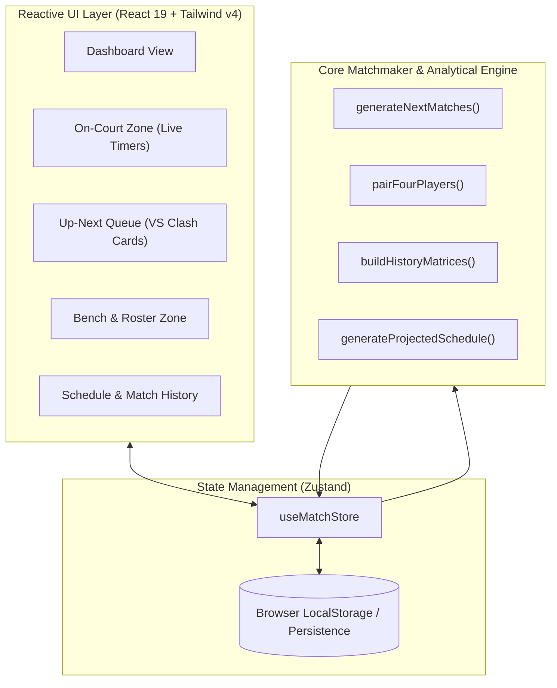

# 🏸 EquiPlay

> **Intelligent Badminton Matchmaking & Court Rotation Engine (Offline-First PWA)**  
> Engineered to eliminate wait-time disputes, repeat matchups, and court-hogging in recreational sessions and club socials.

[](https://equi-play.vercel.app/)
[](https://github.com/prakarsh70/EquiPlay)
[](https://www.typescriptlang.org/)
[](https://react.dev/)
[](https://tailwindcss.com/)
[](https://equi-play.vercel.app/)

---

## ⚡ Live Demo

👉 **Try the live application:** [**https://equi-play.vercel.app/**](https://equi-play.vercel.app/)

*Installable as a Progressive Web App (PWA) on iOS, Android, and Desktop. Works 100% offline in sports halls and gym basements with zero cellular reception.*

---

## 💡 The Problem & The Solution

In social badminton sessions (8–24+ players across 1–4 courts), coordinators face a constant coordination nightmare:
1. **Inequitable Play Time:** People who are vocal get more court time, while quiet players stay on the bench.
2. **Repetitive Matchups:** Without algorithmic pairing, the same 4 players often end up playing together on the same court for the entire session.
3. **Late Arrivals & Walk-ins:** Manually restructuring a tournament bracket when players arrive 20 minutes late or leave early is chaotic.
4. **Physical Impossibility Bugs:** Manually tracking players often leads to accidental duplicate assignments (e.g., Player A assigned to Court 1 and Court 2 simultaneously).

**EquiPlay** is an intelligent, offline-first rotation engine that automates player selection, partner variety, opponent diversity, court rotation, and score logging with mathematical fairness guarantees.

---

## ✨ Key Features

- **⚖️ Fair Wait-Time Weighting:** Dynamically prioritizes players with the fewest games played, longest consecutive bench wait, and arrival order.
- **🔄 Combinatorial Shuffling:** Analyzes match co-occurrence and historical partner frequencies to maximize player variety and rotate players between different courts.
- **🛡️ Strict Physical Player Mutex:** Enforces physical constraints ($\lfloor \text{Active Players} / 4 \rfloor$). A player can **never** be assigned to or started on two courts simultaneously.
- **🤝 Doubles Partner Pairing:** Link two players as teammates (e.g. doubles tournament partners). They will always play together on the same side, while their opponents and courts dynamically rotate.
- **📋 ChatGPT-Style Projected Schedule & Match Log:** Real-time projected fixture table predicting upcoming rounds alongside a complete match history log and leaderboard.
- **🏸 Distinct Visual Metaphors:**
  - **On Court Now:** Authentic badminton court surface lines, net divider, and real-time game timers.
  - **Up Next Queue:** Tactical "VS" duel clash cards with dynamic crossed-rackets and shuttlecock trajectory illustrations.
- **📱 100% Offline-First PWA:** Zero external API or backend dependency. All session state is persisted locally in the browser with full service-worker caching.

---

## 🏗️ System Architecture



---

## 🧠 The Matchmaking Algorithm

EquiPlay does not use static brackets or naive random shuffling. It runs an analytical optimization engine before every match:

### 1. Candidate Selection (Who Plays Next?)
Eligible bench players are ranked using a multi-variable sort:
$$\text{Rank Score} = (\text{Games Played Today}) \uparrow \longrightarrow (\text{Consecutive Games Sat Out}) \downarrow \longrightarrow (\text{Arrival Timestamp}) \uparrow$$
This guarantees that bench-sitters are prioritized immediately when a court opens.

### 2. Cross-Court Partitioning (Co-Occurrence Minimization)
When multiple courts queue up (e.g., 8 players across 2 courts), the engine evaluates candidate partitions:
$$\text{Cost}(G_1, G_2) = \sum_{(u, v) \in G_1} \text{coOccurrence}(u, v) + \sum_{(u, v) \in G_2} \text{coOccurrence}(u, v)$$
It selects the partition that minimizes repeat matchups, guaranteeing that players from Court 1 and Court 2 cross-pollinate.

### 3. Team Formation (Partner Repeat Minimization)
For any 4 drafted players, the engine evaluates all valid doubles configurations:
- **Combo 0:** $[P_0, P_3]$ vs $[P_1, P_2]$
- **Combo 1:** $[P_0, P_2]$ vs $[P_1, P_3]$
- **Combo 2:** $[P_0, P_1]$ vs $[P_2, P_3]$

$$\text{Team Penalty} = 10 \cdot (\text{PartnerRepeatCount}(T_A) + \text{PartnerRepeatCount}(T_B)) + \text{OpponentRepeatCount}$$
The combination with the lowest penalty is chosen, ensuring players rotate teammates every round.

### 4. Court Rotation (Balancing Court Exposure)
Matches are assigned to courts to prevent players from staying on the exact same physical court back-to-back:
$$\text{Court Cost}(m, c) = \sum_{p \in m} \left(2 \cdot \text{gamesOnCourt}(p, c) + 4 \cdot [\text{lastCourt}(p) == c]\right)$$

---

## 🛠️ Tech Stack

| Technology | Purpose |
| :--- | :--- |
| **React 19** | Concurrent UI rendering and component architecture |
| **TypeScript 7** | End-to-end type safety, strict interface contracts |
| **Tailwind CSS v4** | Modern theme styling, utility-first UI design system |
| **Zustand** | Lightweight, high-performance global state machine |
| **Vitest** | Comprehensive unit & integration testing suite (27 passing tests) |
| **Vite 8** | Sub-millisecond HMR and optimized production bundling |
| **Vite PWA Plugin** | Service worker lifecycle, web app manifest, offline asset caching |
| **Lucide React** | Clean, accessible iconography |
| **Canvas Confetti** | Session completion celebration effects |
| **Vercel** | Edge deployment and continuous integration |

---

## 🚀 Developer Getting Started

### Prerequisites
- **Node.js**: `v18.0.0` or higher
- **npm**: `v9.0.0` or higher

### 1. Clone the Repository
```bash
git clone https://github.com/prakarsh70/EquiPlay.git
cd EquiPlay
```

### 2. Install Dependencies
```bash
npm install
```

### 3. Start Local Development Server
```bash
npm run dev
```
Open your browser at `http://localhost:5173`.

### 4. Run Test Suite
EquiPlay includes 27 comprehensive tests covering matchmaker algorithms, concurrency, court limits, and store transitions:
```bash
npm test
```

### 5. Build for Production
Compiles TypeScript and creates an optimized PWA bundle in `dist/`:
```bash
npm run build
```

### 6. Preview Production Build
```bash
npm run preview
```

---

## 🧪 Test Coverage Highlights

- `src/utils/ranking.test.ts`: Point differential, win-rate sorting, and tie-breakers.
- `src/utils/matchmaker.test.ts`:
  - Fair rotation priority (bench wait time vs games played).
  - Doubles partner link enforcement.
  - 8-player / 2-court dynamic team and court shuffling across consecutive rounds.
  - 4-player / 1-court partner rotation.
- `src/store/useMatchStore.test.ts`:
  - Player concurrency locks (zero player duplication across courts).
  - Physical court capacity cap: $\lfloor \text{Active Players} / 4 \rfloor$.
  - Walk-in queue auto-prioritization.
  - Inactive player purge and manual lineup validations.

---

## 🗺️ Future Scope & Roadmap

EquiPlay is designed to evolve into a full-fledged club and tournament operations suite. Upcoming initiatives on the roadmap include:

### 1. 📈 Dynamic Skill Balancing & Elo Engine (Glicko-2 / TrueSkill)
- Incorporate skill-tier weighting (Beginner, Intermediate, Advanced) into the combinatorial optimizer.
- Add Glicko-2 / TrueSkill rating calculations based on match margins to balance doubles pairs fairly while keeping partner diversity high.
- Introduce **King of the Court** mode (winners move up a court, losers move down).

### 2. 📺 Court-Side Spectator / TV Kiosk Mode
- Dedicated fullscreen display mode optimized for wall-mounted gym monitors or projectors.
- Real-time court countdown timers, live scores, upcoming queue callouts, and session leaderboard.
- QR code on screen allowing players to scan and see their personalized queue position on their own phones.

### 3. 🔄 Real-Time Multi-Device Sync (P2P / CRDTs)
- Peer-to-peer local synchronization using WebRTC or CRDTs (Yjs / Automerge) over local Wi-Fi.
- Enables court referees or multiple court managers to log scores simultaneously from different phones without requiring an internet connection.

### 4. 🗣️ Audio Umpire (Text-to-Speech Court Callouts)
- Web Speech API integration to automatically vocalize queue announcements when matches are generated:
  > *"Court 2: Sarah and Alex vs. Ken and Maya. Please take the court."*
- Audible countdown chimes when match timers hit the 2-minute and final buzzer marks.

### 5. 🏆 Tournament & League Formats
- Extend beyond recreational open sessions into structured competition:
  - Swiss System tournament generator.
  - Round Robin pools with automatic tie-break resolution.
  - Single/Double elimination brackets with seeding based on social session stats.

### 6. 📤 Social Sharing & WhatsApp Summary Generator
- One-click export of session highlights into clean shareable images formatted for WhatsApp and Instagram stories.
- Session summary reports (CSV/JSON export, Total Court Utilization %, Most Active Player, Longest Rally, Session MVP).

---

## 🤝 Contributing Workflow

We use a feature-branch workflow with Pull Requests:

1. **Fork or create a feature branch:**
   ```bash
   git checkout -b feat/my-new-feature
   ```
2. **Make your changes and verify tests:**
   ```bash
   npm test
   npm run build
   ```
3. **Commit your changes:**
   ```bash
   git commit -m "feat: add support for timed rounds"
   ```
4. **Push to GitHub and open a Pull Request:**
   ```bash
   git push origin feat/my-new-feature
   ```

---

## 📄 License

This project is licensed under the [ISC License](LICENSE).

---

<p align="center">
  Built with 🏸 by badminton players, for badminton players.
</p>

