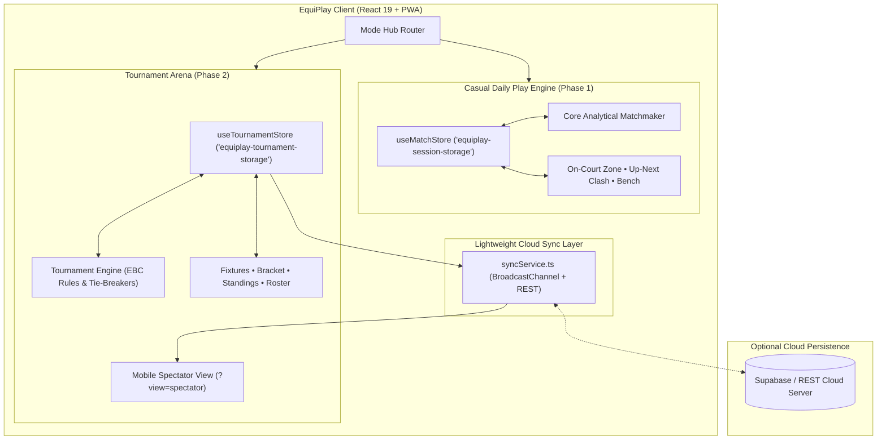
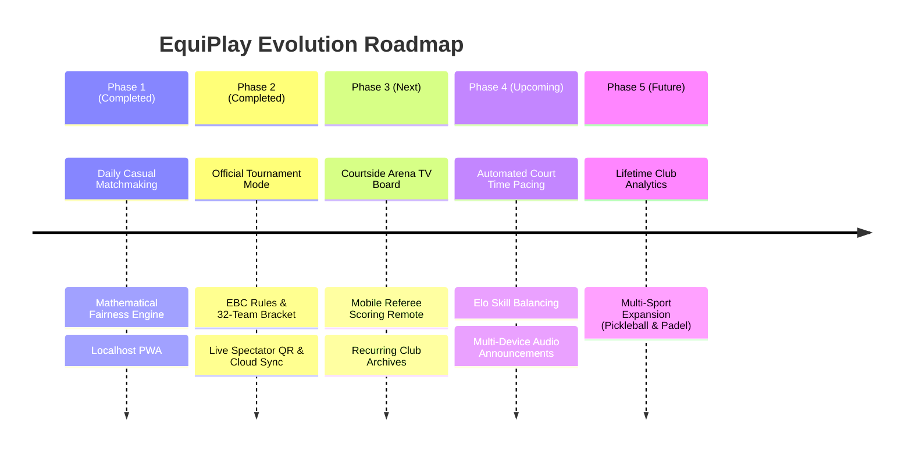

# 🏸 EquiPlay

> **Intelligent Badminton Matchmaking, Court Rotation & Tournament Engine (Offline-First PWA)**  
> Engineered to eliminate wait-time disputes, repeat matchups, and court chaos in club socials and competitive badminton tournaments.

[](https://equi-play.vercel.app/)
[](https://github.com/prakarsh70/EquiPlay)
[](https://www.typescriptlang.org/)
[](https://react.dev/)
[](https://tailwindcss.com/)
[](https://equi-play.vercel.app/)

---

## ⚡ Live Demo

👉 **Try the live application:** [**https://equi-play.vercel.app/**](https://equi-play.vercel.app/)

*Installable as a Progressive Web App (PWA) on iOS, Android, and Desktop. Works 100% offline in sports halls and gym basements with zero cellular reception.*

---

## 💡 The Problem & The Solution

In social sessions and amateur tournaments (8–32+ players across 1–8 courts), organizers face constant coordination nightmares:
1. **Inequitable Play Time:** People who are vocal get more court time, while quiet players stay on the bench.
2. **Repetitive Matchups:** Without algorithmic pairing, the same players play each other on the same court for the entire session.
3. **Tournament Paper Chaos:** Manually tracking 48 group matches and calculating tie-breakers (Points vs. Point Differential vs. Head-to-Head) on clipboards causes delays and disputes.
4. **Spectator Anxiety:** Players constantly swarm the tournament desk asking *"When is my next match?"* and *"What court am I on?"*

**EquiPlay** provides a dual-engine solution:
- **Casual Daily Rotation Mode:** Automates fair queueing, partner variety, opponent diversity, and court rotation with mathematical guarantees.
- **Official Tournament Mode:** Manages professional group-and-knockout championships (e.g. EBC Badminton Championship) with automated tie-breaker standings, live court dispatching, zero-chaos mobile spectator QR views, and cloud sync.

---

## ✨ Key Features

### 🏸 Mode 1: Casual Daily Play Engine (Phase 1)
- **⚖️ Fair Wait-Time Weighting:** Dynamically prioritizes players with the fewest games played, longest consecutive bench wait, and arrival order.
- **🔄 Combinatorial Shuffling:** Analyzes match co-occurrence and historical partner frequencies to maximize variety across courts.
- **🛡️ Strict Physical Player Mutex:** Enforces physical constraints ($\lfloor \text{Active Players} / 4 \rfloor$). A player can **never** be assigned to two courts simultaneously.
- **🤝 Doubles Partner Pairing:** Link two players as permanent partners while opponents and courts rotate dynamically.
- **📋 Projected Schedule & Match Log:** Real-time projected round predictions alongside complete history and session leaderboard.

### 🏆 Mode 2: Official Tournament Arena & Live Spectator System (Phase 2)
- **🌐 Isolated Dual-Engine Hub:** Instant switching between Casual Daily Play and Tournament Mode with zero state leakage.
- **📜 Configurable EBC Rules Schema:** Pre-seeded with official EBC tournament rules (4 arena courts: Courts 2–5, 21-pt pool matches, 15-pt knockouts, 2 pts per win, tie-breakers: Points $\rightarrow$ Differential $\rightarrow$ Points For).
- **🏟️ 32-Team Seeded Roster & 63 Fixtures:** Pre-populated with 32 teams across 8 groups (A–H) and 63 scheduled fixtures (48 group + 8 R16 + 4 QF + 2 SF + 1 Final).
- **⚡ Availability-Driven Court Scheduler:** Automatically detects idle courts and assigns matches sequentially, preventing double-bookings.
- **📊 Real-Time Tie-Breakers & Knockout Auto-Progression:** Computes dynamic standings after every point logged, flags Top 2 qualifiers per group, and auto-populates the 16-team elimination bracket.
- **📲 Live Spectator QR Mode (`?tournamentId=...&view=spectator`):**
  - Read-only, auto-updating mobile dashboard for players and fans.
  - **Live On Court Cards:** Real-time scores and team rosters for Courts 2, 3, 4, 5.
  - **Up Next Queue:** Upcoming matches so players can warm up ahead of time.
  - **Multi-Pool Standings Accordion:** Persistent open/close state and scroll position preservation across updates.
  - **Knockout Bracket Tree:** Clean view of advancing teams.
- **📤 Sharable QR & WhatsApp Snapshot:** Instant high-contrast QR code for courtside scanning and 1-tap formatted WhatsApp snapshot sharing.
- **☁️ Hybrid Cloud Sync (`syncService.ts`):** Offline-first local storage & `BroadcastChannel` with plug-and-play Supabase REST persistence.

---

## 🏗️ System Architecture



---

## 🧠 The Matchmaking & Tournament Engines

### 1. Casual Rotation Optimization
1. **Candidate Priority:**
   $$\text{Rank Score} = (\text{Games Played Today}) \uparrow \longrightarrow (\text{Consecutive Games Sat Out}) \downarrow \longrightarrow (\text{Arrival Timestamp}) \uparrow$$
2. **Cross-Court Shuffling:**
   $$\text{Cost}(G_1, G_2) = \sum_{(u, v) \in G_1} \text{coOccurrence}(u, v) + \sum_{(u, v) \in G_2} \text{coOccurrence}(u, v)$$
3. **Partner Penalty:**
   $$\text{Penalty} = 10 \cdot (\text{PartnerRepeatCount}(T_A) + \text{PartnerRepeatCount}(T_B)) + \text{OpponentRepeatCount}$$

### 2. Official Tournament Engine (EBC Standards)
- **Pool Ranking Formula:**
  $$\text{Priority: Points} \rightarrow \text{Head-to-Head} \rightarrow \text{Point Differential } (\Delta) \rightarrow \text{Total Points For} \rightarrow \text{Seed Number}$$
- **Knockout Bracket Sync:**
  Winners of Pool matches advance deterministically to seeded Round of 16 slots (`A1 vs B2`, `C1 vs D2`, etc.).
- **Automatic Court Availability:**
  Matches start on the first unoccupied court ($\text{Court} \notin \text{LiveCourts}$) preventing arena congestion.

---

## 🛠️ Tech Stack

| Technology | Purpose |
| :--- | :--- |
| **React 19** | Concurrent UI rendering and component architecture |
| **TypeScript 7** | End-to-end strict typing for match contracts and tournament rules |
| **Tailwind CSS v4** | Modern theme styling, utility-first UI design system |
| **Zustand 5** | Isolated state stores (`useMatchStore` & `useTournamentStore`) |
| **qrcode.react** | High-contrast courtside QR code generation |
| **Vitest 5** | Comprehensive test suite (**57 passing unit and integration tests**) |
| **Vite 8** | Sub-millisecond HMR, multi-host local networking (`server.host: true`) |
| **Vite PWA Plugin** | Service worker lifecycle, web app manifest, 100% offline caching |
| **Supabase REST** | Zero-dependency cloud database synchronization for mobile spectators |
| **Lucide React** | Clean, accessible sports & tournament iconography |
| **Canvas Confetti** | Celebration visual effects on championship completion |
| **Vercel** | Edge deployment and continuous integration |

---

## 🚀 Developer Getting Started

### Prerequisites
- **Node.js**: `v18.0.0` or higher
- **npm**: `v9.0.0` or higher

### 1. Clone the Repository
```bash
git clone https://github.com/prakarsh70/EquiPlay.git
cd EquiPlay
```

### 2. Install Dependencies
```bash
npm install
```

### 3. Local Development
```bash
npm run dev
```
Vite automatically serves locally and across your Wi-Fi network:
```
  ➜  Local:   http://localhost:5173/
  ➜  Network: http://192.168.x.x:5173/
```
Open on your computer or test on your phone over Wi-Fi.

### 4. Optional: Cloud Sync on Cellular (Supabase)
To allow players on cellular 4G/5G outside local Wi-Fi to receive live spectator updates:
1. Create a free project at [supabase.com](https://supabase.com).
2. Run this table creation script in the **Supabase SQL Editor**:
   ```sql
   create table if not exists tournaments (
     tournament_id text primary key,
     data jsonb not null,
     updated_at timestamptz default now()
   );
   alter table tournaments disable row level security;
   ```
3. Copy your **Project URL** and **Anon API Key** into a `.env` file:
   ```env
   VITE_SUPABASE_URL=https://your-project.supabase.co
   VITE_SUPABASE_ANON_KEY=your-anon-public-key
   ```
4. Restart Vite (`npm run dev`).

### 5. Run Test Suite
EquiPlay includes **57 comprehensive automated tests**:
```bash
npm test
```

### 6. Build for Production
```bash
npm run build
```

---

## 🧪 Test Coverage Highlights (57 Tests)

- `src/utils/tournamentEngine.test.ts`:
  - EBC group standings, points-per-win/loss calculations.
  - Multi-tier tie-breakers (Points $\rightarrow$ Point Differential $\rightarrow$ Points For).
  - Knockout tree propagation from Pool qualifiers into R16, QF, SF, and Finals.
  - Walkover awards (`awardWalkover`) with automatic 21-0 scores.
- `src/store/useTournamentStore.test.ts`:
  - 32-team initialization and 63-fixture generation.
  - Setup immutability enforcement once matches have started.
  - Automatic court assignment based on court availability.
  - Score logging, winner determination, and store reset.
- `src/utils/matchmaker.test.ts`:
  - Fair rotation priority (bench wait time vs games played).
  - Doubles partner link enforcement.
  - 8-player / 2-court dynamic team and court shuffling.
  - 4-player / 1-court partner rotation.
  - **10-Player Combinatorial Diversity**: Validates deliberate partnership across clusters (solving #3).
  - **Session Sequence Planner**: Generates multi-match timeline with time slots and resting breakdowns.
  - **Mathematical Impossibility Reporting**: Flags when zero back-to-back or equal games are impossible.
- `src/store/useMatchStore.test.ts`:
  - Physical player mutex locks (zero duplicate player assignments).
  - Physical court capacity cap: $\lfloor \text{Active Players} / 4 \rfloor$.
  - Walk-in queue auto-prioritization.
  - **Match Deletion & State Reversal**: Validates decremented games played and restored wait states (solving #4).
  - Active match cancellation and upcoming queue replenishment.
- `src/utils/ranking.test.ts`: Point differential, win-rate sorting, and tie-breakers.

---

## 🗺️ Product Roadmap & Architectural Phases



### ✅ Phase 1: Daily Court Rotation & Session Management — [COMPLETED]
- 100% offline-first PWA for casual badminton sessions (`useMatchStore`).
- Mathematical fairness engine balancing court time, bench wait penalty, and opponent variety.
- Multi-court live queue, late walk-in arrival timestamps, and doubles partner linking.

### ✅ Phase 2: Tournament Arena, Official Rules & Real-Time Spectator Mode — [COMPLETED]
- Dual-mode architecture isolating Casual Daily Play from Tournament Mode (`useTournamentStore`).
- Configurable rules schema seeded with official EBC tournament defaults.
- 32-team World Cup format (8 groups of 4 doubles pairs, 48 round-robin matches + 15 knockout matches).
- Availability-driven court allocator assigning free courts dynamically.
- Live tie-breaker engine with automatic progression from group qualifiers into the Round of 16 bracket.
- Zero-chaos Mobile Spectator Dashboard (`?view=spectator`) with live court scores, up-next queue, multi-pool accordion, and bracket views.
- Sharable high-contrast QR code modal and WhatsApp live summary generator.
- Pluggable cloud synchronization layer (`syncService.ts`) with Supabase REST integration.

### 🔜 Phase 3: Arena TV Display & Courtside Umpire Remote Network — [UPCOMING]
- **🖥️ Full-Screen Arena TV Display Mode (`?view=tv`):** Ultra-high contrast, large-type scoreboard dashboard designed for ceiling projectors, court-side tablets, and HDMI monitors.
- **📱 Umpire Scoring Remote (`?view=umpire&court=Court2`):** Simplified touch remote for court chair umpires to score points point-by-point, sync live rally scores, and trigger service court changes.
- **📢 Voice Call-Outs (Web Speech API):** Automatic audio announcements over arena PA (e.g. *"Court 3: Match G-B-4, Team Tanay & Rohit please report to court"*).
- **📂 Recurring Club Tenancy & Roster Vault:** Multi-tournament history archives, club member databases, and past championship records.

### 🔮 Phase 4: Dynamic Matchmaking & Pacing Upgrades
- **⏱️ Booking Time-Panic Loop:** Automatic match duration forecasting comparing elapsed session time against venue booking end, auto-tapering point caps (21 $\rightarrow$ 15 $\rightarrow$ 11) in final 30 minutes.
- **📈 Elo / DUPR Skill Rating Integration:** Seed teams by skill tier to balance pools and prevent early-round blowouts.

### 🌟 Phase 5: Lifetime Analytics & Multi-Sport Scale
- **📊 Club Synergy & Head-to-Head Analytics:** Lifetime partner win rates, nemesis tracking, and attendance badges.
- **🏸 Multi-Racket Expansion:** Generalize scoring caps, service rules, and court layouts for **Pickleball**, **Padel**, **Squash**, and **Table Tennis**.

---

## 🤝 Contributing

We use a feature-branch workflow with Pull Requests:

1. Fork or branch: `git checkout -b feat/my-feature`
2. Test changes: `npm test && npm run build`
3. Commit: `git commit -m "feat: description"`
4. Push and open PR: `git push origin feat/my-feature`

---

## 📄 License

This project is licensed under the [ISC License](LICENSE).

<p align="center">
  Built with 🏸 by badminton players, for badminton players.
</p>
